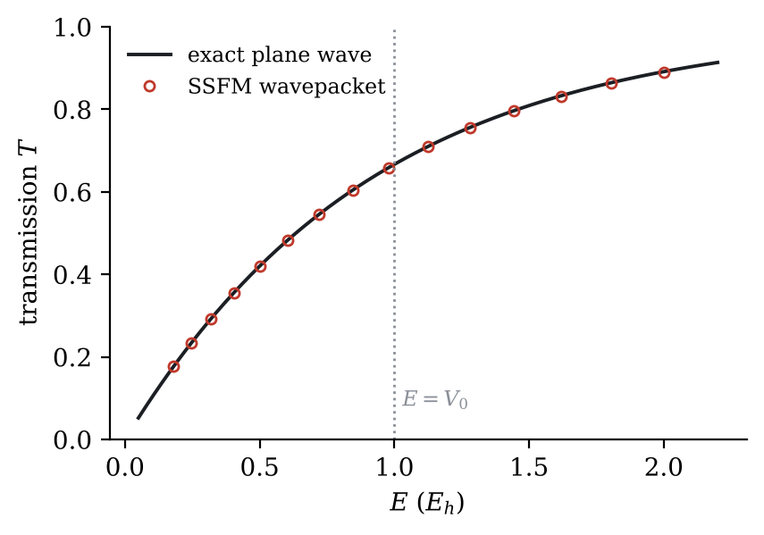
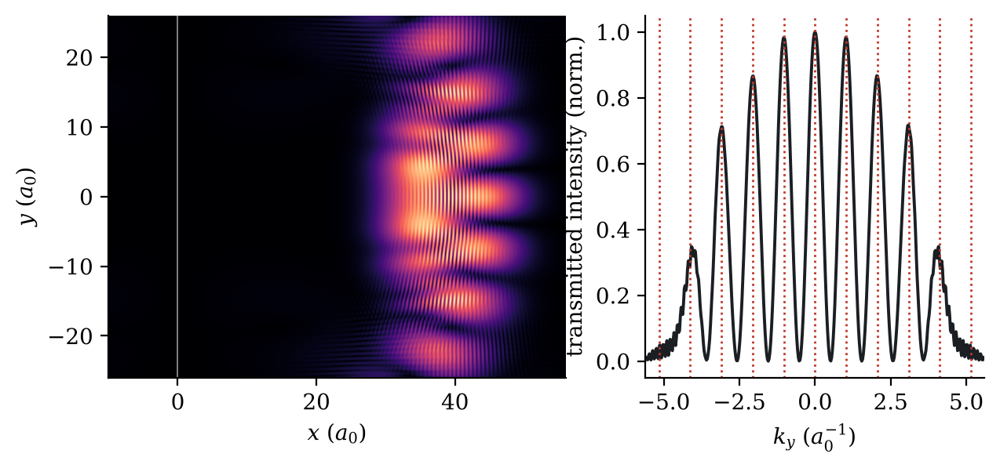
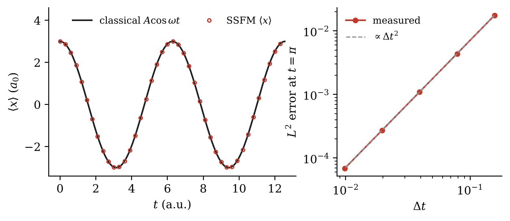

# Split-step Fourier solver for the time-dependent Schrödinger equation

A short, tested Python implementation of the split-step Fourier method (Strang splitting) for

$$ i\hbar\,\partial_t\psi = \left[-\frac{\hbar^2}{2m}\nabla^2 + V(\mathbf r)\right]\psi $$

in one and two dimensions. It is checked against **five problems with exact answers**. The full write-up is in [`paper/Alazemi_TDSE_Split_Step_Fourier.pdf`](paper/Alazemi_TDSE_Split_Step_Fourier.pdf).

Atomic units are used throughout (ħ = m = 1).

## The method in one paragraph

The kinetic term is diagonal in momentum space and the potential is diagonal in position space. Each time step therefore does five things:

1. Apply half a potential kick, e^{−iVΔt/2}.
2. FFT to momentum space.
3. Apply a full kinetic kick, e^{−ik²Δt/2}.
4. Inverse FFT back to position space.
5. Apply the second half potential kick.

Every factor has modulus 1, so the scheme is **unitary**: probability is conserved to machine precision. Because the splitting is symmetric, the error is **second order in Δt**. Each step costs O(N log N).

```python
class SSFM:
    def __init__(self, V, k2, dt):
        self.half_V = np.exp(-1j * V * dt / 2)
        self.full_T = np.exp(-1j * k2 * dt / 2)

    def step(self, psi, n=1):
        for _ in range(n):
            psi = self.half_V * psi
            psi = np.fft.ifft(self.full_T * np.fft.fft(psi))
            psi = self.half_V * psi
        return psi
```

A complex potential (negative imaginary part) acts as an absorbing layer at the edges of the box. This stops outgoing waves from wrapping around the periodic boundary.

## Results

| # | Test | Exact reference | Agreement |
|---|------|-----------------|-----------|
| 1 | Free Gaussian packet | σ(t) = σ₀√(1 + (t/2σ₀²)²) | width error ~10⁻¹⁴; norm conserved to 10⁻¹⁴ |
| 2 | Square-barrier tunnelling, 15 energies | plane-wave T(E), averaged over the packet | max \|ΔT\| = 4.6 × 10⁻⁴ |
| 3 | Coherent state in a harmonic trap | ⟨x⟩ = A cos ωt | max \|Δ⟨x⟩\| = 1.4 × 10⁻⁴; convergence slope 2.000 |
| 4 | 2D double slit | fringes at k_y = 2πm/d | all five orders within one k-grid bin (~1%) |
| 5 | Reflection above a potential step | R = ((k₁−k₂)/(k₁+k₂))² | max \|ΔR\| = 7.7 × 10⁻⁵ |

<p align="center">
  
  
</p>
<p align="center">
  
</p>

## What went wrong, and how it was fixed

Most of the error came from numerical set-up, not from the physics:

- **Periodic wrap-around.** In a box that is too small (L = 20), the spreading packet's tail re-enters from the other side. This produced a fake 1.6% error in σ(t). Doubling the box removed it.
- **Grid alignment.** A barrier written as `|x| <= a` covers one extra grid cell, which makes it about 3% too wide and shifts T by about 0.015. With dx = 1/32 and a half-open interval, the barrier is exactly 32 cells wide. The unit test `test_barrier_transmission_matches_exact_result` checks this.
- **Packet versus plane wave.** A wavepacket has a spread of momenta. It must be compared with T(E) *averaged over that spread*, not with T at the central energy.
- **Measuring the convergence order.** I compared runs against a much finer reference run, keeping the end time identical in every run. This gave a measured slope of 2.000.

## Repository layout

```
ssfm.py                  solver + exact reference formulas (the only module you need)
simulations/             one script per test, plus figures.py
tests/test_ssfm.py       fast unit tests (~2 s)
run_all.py               reproduces every number and figure in the paper
figures/                 the paper's figures
paper/                   the write-up (PDF)
results/                 intermediate data written by the simulations (git-ignored)
```

## Running it

```bash
pip install -r requirements.txt
python -m pytest -q          # 4 tests, ~2 seconds
python run_all.py            # all simulations + figures (the 2D double slit takes a few minutes)
python run_all.py --quick    # 1D simulations only
```

## Ideas for extensions

- Higher-order splittings (Yoshida, fourth order).
- Imaginary-time propagation to find ground states.
- The nonlinear Gross–Pitaevskii equation (Bose–Einstein condensates).
- A time-dependent laser field, for strong-field ionisation.

## Author

Mohammed Alazemi, BSc Physics, The University of Manchester. Released under the MIT licence.
